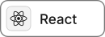
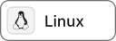

## Technologies

  <strong>LANGUAGES</strong> 
  <picture>
    <source media="(prefers-color-scheme: dark)" srcset="./assets/badges/dark/typescript.svg">
    
  </picture>
  <picture>
    <source media="(prefers-color-scheme: dark)" srcset="./assets/badges/dark/javascript.svg">
    
  </picture>

  <strong>FRONTEND</strong> 
  <picture>
    <source media="(prefers-color-scheme: dark)" srcset="./assets/badges/dark/vue-3.svg">
    
  </picture>
  <picture>
    <source media="(prefers-color-scheme: dark)" srcset="./assets/badges/dark/nuxt.svg">
    
  </picture>
  <picture>
    <source media="(prefers-color-scheme: dark)" srcset="./assets/badges/dark/react.svg">
    
  </picture>
  <picture>
    <source media="(prefers-color-scheme: dark)" srcset="./assets/badges/dark/next-js.svg">
    
  </picture>
  <picture>
    <source media="(prefers-color-scheme: dark)" srcset="./assets/badges/dark/tailwind-css.svg">
    
  </picture>
  <picture>
    <source media="(prefers-color-scheme: dark)" srcset="./assets/badges/dark/scss.svg">
    
  </picture>

  <strong>STATE MANAGEMENT</strong> 
  <picture>
    <source media="(prefers-color-scheme: dark)" srcset="./assets/badges/dark/pinia.svg">
    
  </picture>
  <picture>
    <source media="(prefers-color-scheme: dark)" srcset="./assets/badges/dark/redux-toolkit.svg">
    
  </picture>
  <picture>
    <source media="(prefers-color-scheme: dark)" srcset="./assets/badges/dark/effector.svg">
    
  </picture>

  <strong>BACKEND & DATA</strong> 
  <picture>
    <source media="(prefers-color-scheme: dark)" srcset="./assets/badges/dark/node-js.svg">
    
  </picture>
  <picture>
    <source media="(prefers-color-scheme: dark)" srcset="./assets/badges/dark/nestjs.svg">
    
  </picture>
  <picture>
    <source media="(prefers-color-scheme: dark)" srcset="./assets/badges/dark/postgresql.svg">
    
  </picture>
  <picture>
    <source media="(prefers-color-scheme: dark)" srcset="./assets/badges/dark/mongodb.svg">
    
  </picture>

  <strong>TOOLING</strong> 
  <picture>
    <source media="(prefers-color-scheme: dark)" srcset="./assets/badges/dark/git.svg">
    
  </picture>
  <picture>
    <source media="(prefers-color-scheme: dark)" srcset="./assets/badges/dark/docker.svg">
    
  </picture>
  <picture>
    <source media="(prefers-color-scheme: dark)" srcset="./assets/badges/dark/sentry.svg">
    
  </picture>
  <picture>
    <source media="(prefers-color-scheme: dark)" srcset="./assets/badges/dark/linux.svg">
    
  </picture>
  <picture>
    <source media="(prefers-color-scheme: dark)" srcset="./assets/badges/dark/postman.svg">
    
  </picture>

